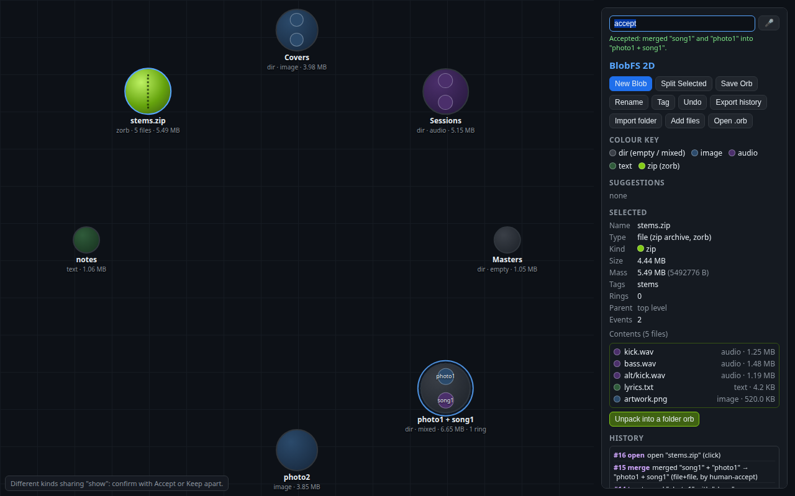
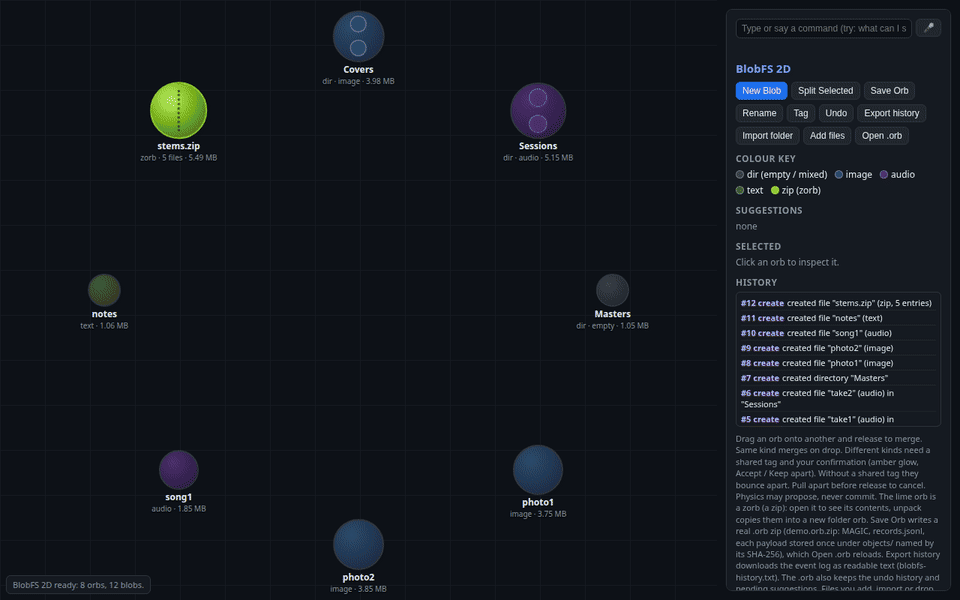

# BlobFS

[](https://github.com/baresteelx-star/blobfs-orb/actions/workflows/test.yml)

BlobFS is a file format and a small file system in which files are blobs that attract, merge, and split. A merge is a stored operation with an append-only history. The system may propose a merge. A person commits it. Undo is a new event, so the merge stays in the log. Payloads are stored once, named by their SHA-256 hash, inside a zip called an `.orb`.

The format is implemented twice: [`blobfs-2d.html`](blobfs-2d.html), a browser page with its own zip reader and writer, and [`orb.py`](orb.py), a Python reference that uses only the standard library.

## Paper

[Merge by Kind, Commit by Hand: The BlobFS File Format](paper/blobfs-paper.md) by Kenneth Santala. Related work and the reference list are in [paper/related-work.md](paper/related-work.md). An arXiv source bundle (LaTeX, bibliography, figure, built PDF, and submission notes) is in [paper/arxiv/](paper/arxiv/). It has not been submitted.

## Browser demo

Open [`blobfs-2d.html`](blobfs-2d.html) in a browser (a local `file://` URL is enough; the page does not load anything from the network). A GitHub Actions workflow ([`.github/workflows/pages.yml`](.github/workflows/pages.yml)) publishes that page and [`demo.orb`](demo.orb) to [https://baresteelx-star.github.io/blobfs-orb/](https://baresteelx-star.github.io/blobfs-orb/) when the default branch is built. That URL stays empty until the repository owner sets **Settings → Pages → Build and deployment → Source** to **GitHub Actions**. The page does not fetch `demo.orb` by itself; the archive is at [https://baresteelx-star.github.io/blobfs-orb/demo.orb](https://baresteelx-star.github.io/blobfs-orb/demo.orb) for download, then **Open .orb**. The page starts with a sample disk of eight orbs. Drag one orb onto another to merge. Same-kind drops commit. Different kinds need a shared tag and an Accept. The lime orb is a zorb, a zip: open it to list the entries, unpack to copy them into a new folder.

To open the committed archive, click **Open .orb** and choose [`demo.orb`](demo.orb). **Save Orb** downloads `demo.orb.zip`. The command bar takes typed commands (`what can I say?` lists them). Spoken commands use the Web Speech API and are available in Chrome and Edge; typing works in every browser.





## Python reference

`orb.py` reads and writes the same `.orb` zip. From the repository root:

```sh
python3 orb.py verify demo.orb
python3 orb.py info demo.orb
```

`verify` checks the magic header, every CRC-32, every payload SHA-256, links, and masses. `info` prints the tree as JSON. In Python, `orb.load(path)` returns a `Disk`; `orb.save(disk, path)` writes one. `Disk.merge` refuses `confirmed_by="physics"`.

The same code is the `orb` package in [`src/orb`](src/orb). From a checkout:

```sh
pip install .
orb verify demo.orb
```

That install is local. The package is not on PyPI. Saved archives still record the writer name `orb.py`.

## Tests

The suite is 20 pure-Python tests in [`tests/test_orb.py`](tests/test_orb.py), 12 tests in [`tests/test_crosslang.py`](tests/test_crosslang.py) (9 pure Python and 3 cross-language), and 106 Playwright checks per browser in [`tests/browser_suite.js`](tests/browser_suite.js). The three cross-language tests need Node, the `playwright` package, and Chromium and Firefox. If those are missing they are skipped, not failed. The browser script requires Playwright and exits if it cannot start. It includes a sparse 4 GiB file (`truncate`) refused by the page's file input, and spoken commands from a fake Web Speech API.

```sh
npm ci
npx playwright install --with-deps chromium firefox
npm test
```

`npm test` runs `python3 -m unittest -v tests.test_orb tests.test_crosslang` and then `node tests/browser_suite.js` (Chromium and Firefox). To run one browser: `node tests/browser_suite.js chromium`.

GitHub Actions runs the same commands on push and pull request (`.github/workflows/test.yml`), then builds a wheel and runs `orb verify demo.orb`. The wheel is not uploaded.

## Benchmarks

Warm open times, for orb.py and for the page in Chromium and Firefox:

```sh
bash bench/run_all.sh
```

Cold-cache times drop the guest page cache before every run and need passwordless `sudo`:

```sh
bash bench/run_cold.sh
```

Recorded numbers are in [bench/results-2026-10-11.txt](bench/results-2026-10-11.txt), [bench/results-cold-2026-10-11.txt](bench/results-cold-2026-10-11.txt), [bench/results-2026-10-19.txt](bench/results-2026-10-19.txt), [bench/results-cold-2026-10-19.txt](bench/results-cold-2026-10-19.txt), [bench/results-gha-2026-10-19.txt](bench/results-gha-2026-10-19.txt), and [bench/results-cold-gha-2026-10-19.txt](bench/results-cold-gha-2026-10-19.txt), and in Section 5 of the paper. The 2026-10-11 guest, the 2026-10-19 guest, and the 2026-10-19 GitHub-hosted runner are different machines. GitHub Actions runs the same scripts in [`.github/workflows/benchmarks.yml`](.github/workflows/benchmarks.yml), separately from the test workflow. One successful run of that job (2026-10-19, run 39296171414) is the Actions table in the paper.
